<p align="center">
  <a href="https://lumi-lattice.vercel.app">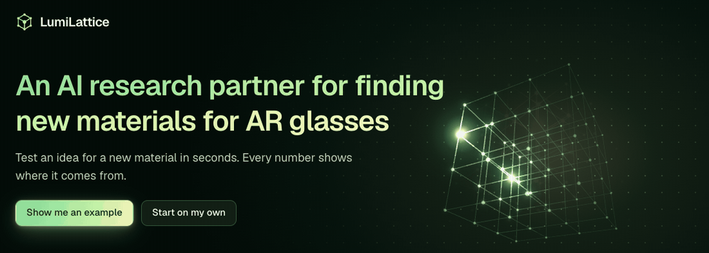</a>
</p>

<h1 align="center">LumiLattice</h1>

<p align="center"><strong>An AI research partner for finding new materials for AR glasses.</strong><br>
Test an idea for a new material in seconds. Every number shows where it comes from.</p>

<p align="center">
  <a href="https://lumi-lattice.vercel.app"><strong>Open the live demo</strong></a> ·
  <a href="#try-it-in-one-minute">Try it in one minute</a> ·
  <a href="#a-tour-of-the-app">Tour</a> ·
  <a href="#7-work-in-public-or-in-private">Public and private</a> ·
  <a href="#how-muse-spark-is-used">Muse Spark</a> ·
  <a href="#the-science">The science</a> ·
  <a href="#run-locally">Run locally</a>
</p>

Built for the Meta Global AI Developer Hackathon (Oct 27 – Nov 4, 2026), track **Push the Frontier**.

**At a glance:**

- **Propose:** swap atoms in a known crystal, by hand or with the Muse Spark research agent.
- **Check:** see the new structure in 3D, with structural checks, a score with stated uncertainty, and a novelty check.
- **Trust the numbers:** scientific tools compute each value, and each value shows its source and how strong it is.
- **Decide:** you accept, revise, or reject each candidate, and Muse Spark works from your reason.
- **Keep or share:** work in public with no sign-in, or in private with Google sign-in. Publish your own material with your credit, if no owner has published it yet.
- **For everyone:** Guided mode uses plain words, Expert mode shows all tools, and the site is available in 6 languages.

## Why this exists

AR glasses send a picture through a thin piece of clear material, called a waveguide. The material must do two things at once:

- **Bend light strongly.** This is a high refractive index, $`n`$.
- **Stay clear.** This is a wide band gap, $`E_g`$. A narrow gap absorbs blue light and makes the picture yellow.

Few materials do both, because the two properties usually trade against each other. The empirical Moss relation describes this trend:

```math
n^4 E_g \approx 95\ \text{eV}
```

<p align="center">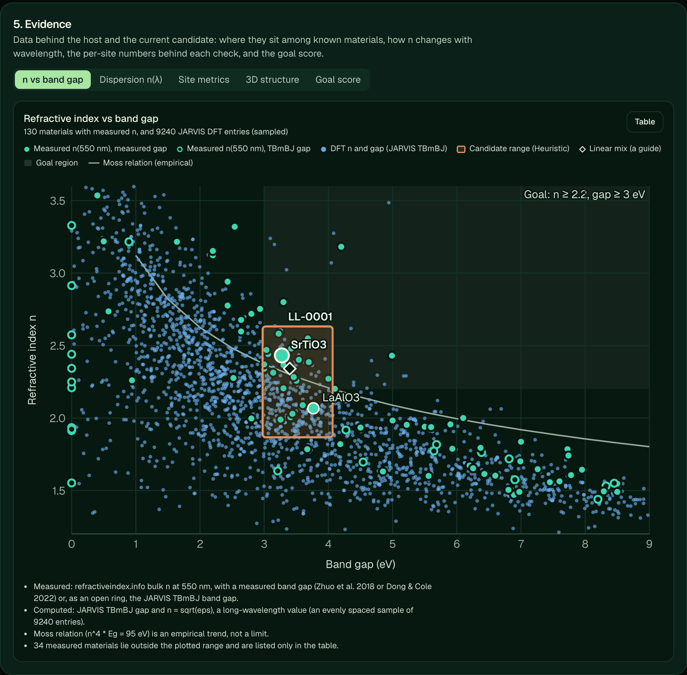</p>
<p align="center"><sub>Each dot is a known material. The goal region is at the upper right, where few materials reach. The orange box is the range for one candidate, between SrTiO<sub>3</sub> and LaAlO<sub>3</sub>. Data: refractiveindex.info, JARVIS-DFT, Zhuo et al., Dong &amp; Cole.</sub></p>

LumiLattice helps you search that empty corner. You pick a known crystal and swap some of its atoms. The app builds the new structure, checks it, and scores it against your goal. **Meta Muse Spark** plans the work, explains the result, and suggests the next test. Scientific tools compute every number, and you make every decision.

> [!IMPORTANT]
> A candidate is an idea to test, not a proven material. The score ranks ideas. It does not say that a material can be made or will work. A simulation or a lab sample is the real test.

## Try it in one minute

1. Open the **[live demo](https://lumi-lattice.vercel.app)**. You do not need an account.
2. Select **Show me an example**. The app sets the AR goal ($`n \ge 2.2`$, $`E_g \ge 3.0`$ eV), selects SrTiO<sub>3</sub>, and replaces 25% of Sr with La and 25% of Ti with Al.
3. Read the result. It says what the candidate means for your goal and how sure the evidence is.
4. Select **Explain this to me** or **Suggest a better swap** to ask Muse Spark.
5. Record your decision and a reason. **Modify** and **Explore alternatives** send the reason to the agent, which tries again.
6. To keep your work from other users, select **Private** at the top and sign in with Google. See [Work in public or in private](#7-work-in-public-or-in-private).

<p align="center">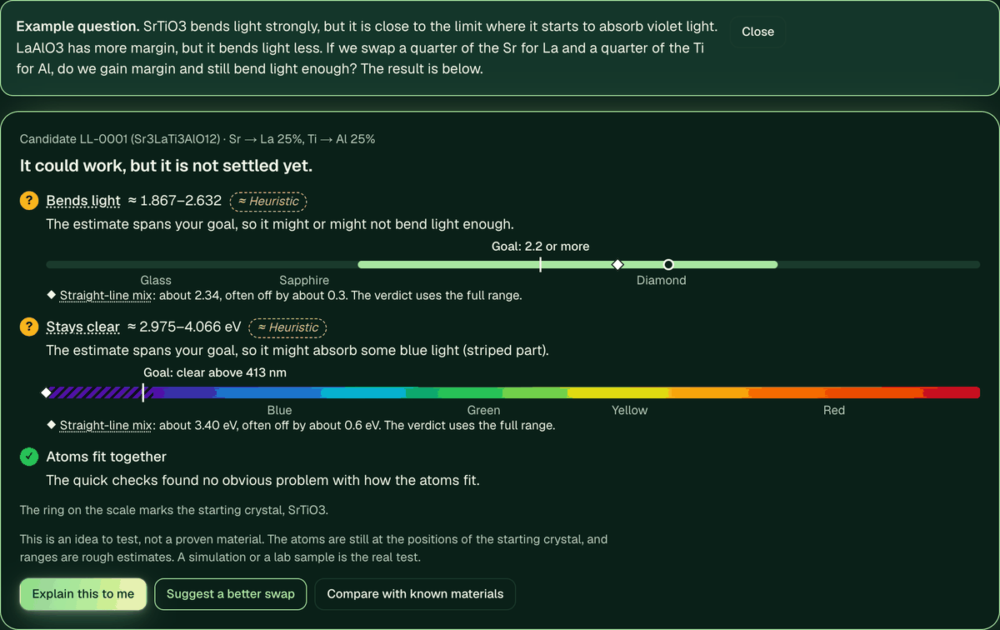</p>
<p align="center"><sub>The result in Guided mode, with no formula to know first. Scales put each range next to familiar materials and the colors of the spectrum.</sub></p>

> [!NOTE]
> In both modes, do not enter confidential work. Private mode keeps your candidates from other users, but it does not make them secret. Muse Spark requests are limited to 10 for each client in 10 minutes, to protect the API credits.

<details>
<summary><strong>Guided mode and Expert mode</strong></summary>

LumiLattice is for researchers and for people new to the field. The app opens in **Guided** mode; **Expert** mode shows every tool at once. The choice is remembered in the browser.

Guided mode has these parts:

- **Why this exists.** A short statement of the problem (AR glasses need a material that bends light strongly and stays clear), what you do here, what you get, and what the tool cannot do.
- **Plain step names and starting points.** "Your goal, starting crystal, swap atoms, read the result". Four suggested starting crystals mean that nobody has to know a formula first.
- **Scales instead of bare numbers.** n is shown against glass, sapphire, and diamond. The band gap is shown on the visible spectrum, with the absorbed part darkened and the uncertain part striped.
- **A plain result.** Each candidate opens with what it means for your goal, how sure the evidence is, and buttons to have Muse Spark explain it or suggest a better swap. The verdicts are the same deterministic goal score that Expert mode shows.
- **A glossary.** Select an underlined term or an evidence tag to read a short definition.
- **Muse Spark in plain language.** In Guided mode, the agent and the critique explain technical terms and stay short. The rules on numbers do not change.

Nothing is removed: export, relaxation, publishing, lab results, and the checks move behind a click. Two evidence views (dispersion and site metrics) and the 3D structure analysis are in Expert mode.

</details>

## A tour of the app

All pictures below come from one example: candidate **LL-0001** (Sr<sub>3</sub>LaTi<sub>3</sub>AlO<sub>12</sub>), made from SrTiO<sub>3</sub> ([mp-5229](https://next-gen.materialsproject.org/materials/mp-5229)).

### 1. Set a goal

Choose the $`n`$ and the band gap that you need. The app converts the gap to the color where absorption starts:

```math
\lambda_\text{edge}\,[\text{nm}] = \frac{hc}{E_g} \approx \frac{1240}{E_g\,[\text{eV}]}
```

```math
E_g = 3.0\ \text{eV} \;\Rightarrow\; \lambda_\text{edge} \approx 413\ \text{nm}
```

<p align="center">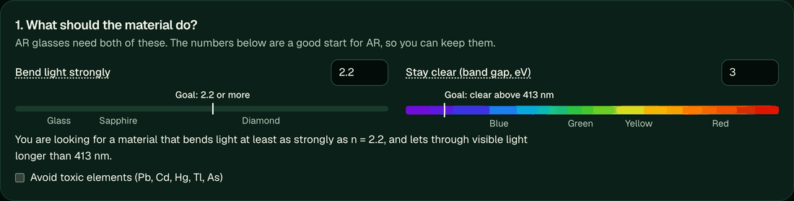</p>
<p align="center"><sub>The goal. Every candidate is scored against it.</sub></p>

### 2. See the crystal in 3D

<table>
  <tr>
    <td width="50%" align="center">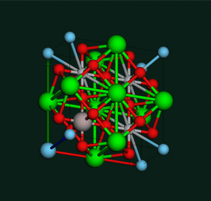</td>
    <td width="50%" align="center">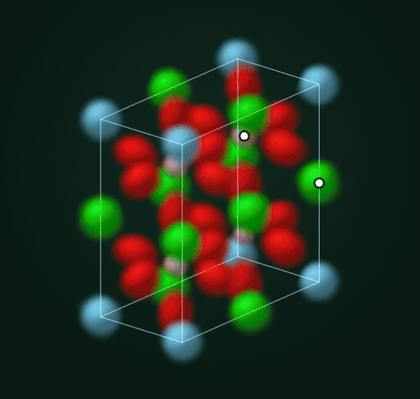</td>
  </tr>
  <tr>
    <td align="center"><strong>Balls and sticks</strong><br><sub>La (blue), Sr (green), O (red), Ti (gray), Al (pink). Larger atoms are the swapped sites. Drawn with 3Dmol.js.</sub></td>
    <td align="center"><strong>Electron cloud</strong><br><sub>Same crystal and colors. White dots mark the swapped atoms. Drawn with our own WebGL2 ray marcher.</sub></td>
  </tr>
</table>

The cloud view is **a model picture, not a computed electron density**. Each atom gets a soft Gaussian. Its size comes from the ionic radius, and it stretches along the atom's bonds. Color it by direction to see which way each cloud stretches:

<p align="center">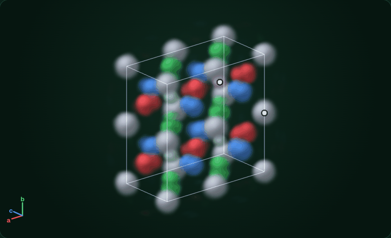</p>
<p align="center"><sub>Cloud color by direction: red, green, and blue clouds stretch along a, b, and c. Gray clouds are round. Oxygen clouds stretch toward their two metal neighbors.</sub></p>

Seven structural checks run on each candidate. Select a check to highlight its atoms in the 3D view:

<p align="center">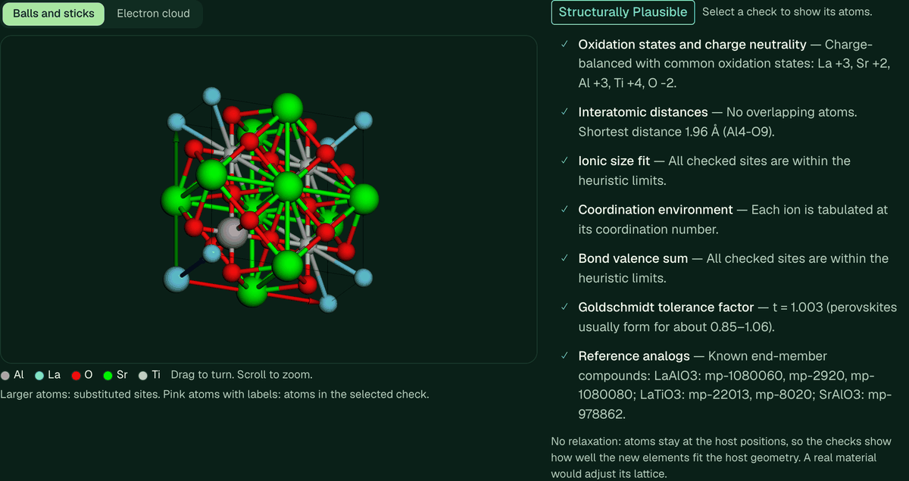</p>
<p align="center"><sub>The checks, with numbers and atoms. They show how well the new atoms fit the host. They do not predict whether a material can be made.</sub></p>

### 3. Read the score

The score is always a **range**, from the worst to the best end of the evidence. Weak evidence gives a wide range, not a false precise number. Here it is 55 to 90.

<p align="center">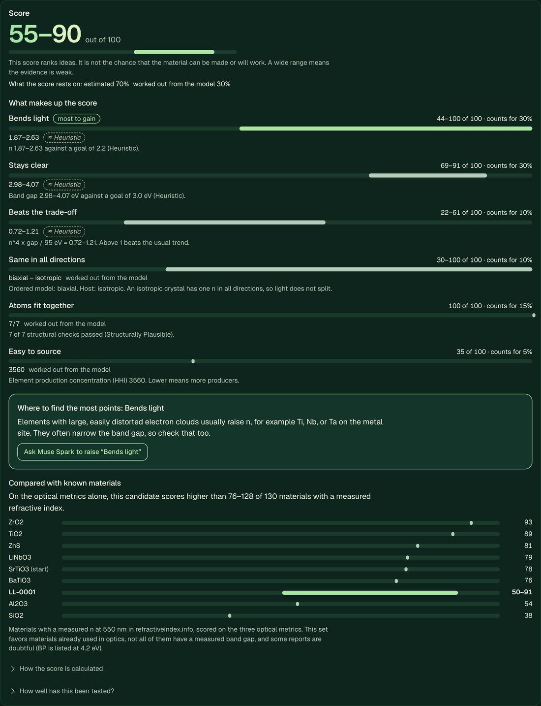</p>
<p align="center"><sub>Six metrics, each with its range, weight, and evidence tag. The panel names the metric with the most points still open, and compares the candidate with well-known optical materials.</sub></p>

### 4. Ask how new it is

A new material is not automatically a good one, so novelty is a separate answer with four levels. The app never calls a candidate a discovery.

<p align="center">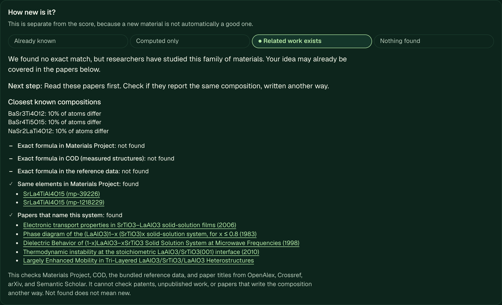</p>
<p align="center"><sub>Each check is listed with links. &quot;Not found&quot; does not mean new: the app cannot check patents, unpublished work, or other notations.</sub></p>

### 5. Look at the evidence

Every value has one of four tags: `Experimental`, `DFT-computed`, `Heuristic`, or `Unknown`. Chart colors use a palette checked for color-vision deficiency, and each chart also has a table view.

<p align="center">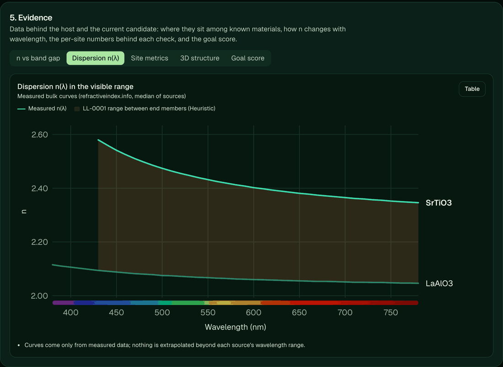</p>
<p align="center"><sub>Measured n(λ) of the two end members, with no extrapolation. The band between them is the candidate's range. Data: refractiveindex.info.</sub></p>

<p align="center">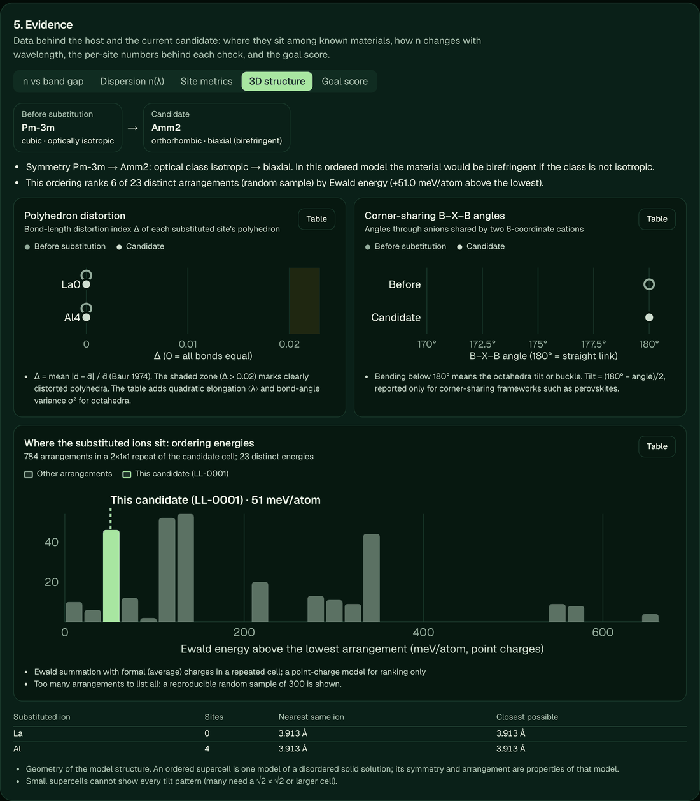</p>
<p align="center"><sub>3D structure analysis: symmetry, polyhedra, and links between them. The histogram ranks this arrangement of atoms among the others by Ewald energy.</sub></p>

<p align="center">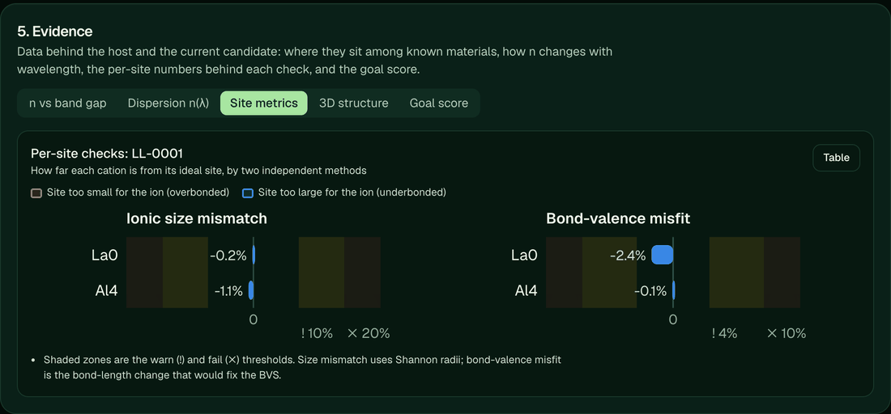</p>
<p align="center"><sub>Per-site numbers against the warning and failure thresholds.</sub></p>

### 6. Let Muse Spark review it, then decide

Muse Spark reads the evidence and three rendered views of the crystal. Each point must cite an evidence ID, and the app flags any number that is not in the evidence. You then record your own decision.

<p align="center">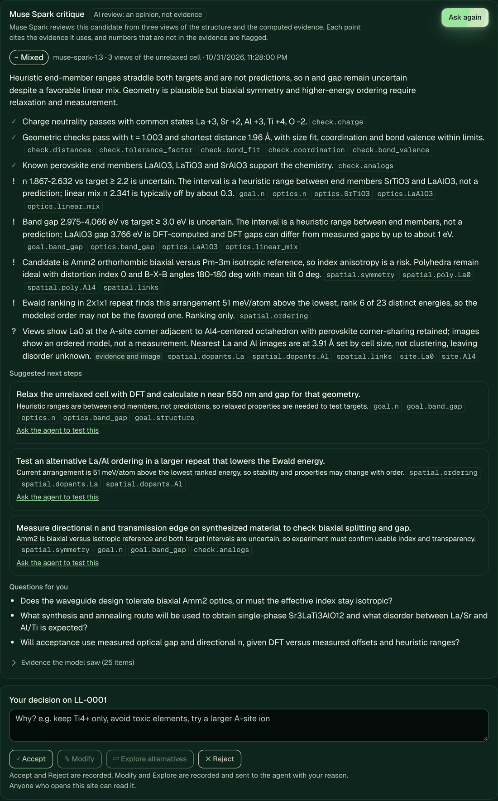</p>
<p align="center"><sub>Real output from Muse Spark, labeled &quot;AI review: an opinion, not evidence&quot;. It cannot change a tag, a check, or a score.</sub></p>

You can also talk to the research agent. It sees the selected host and candidate, calls the tools, and remembers the conversation.

<p align="center">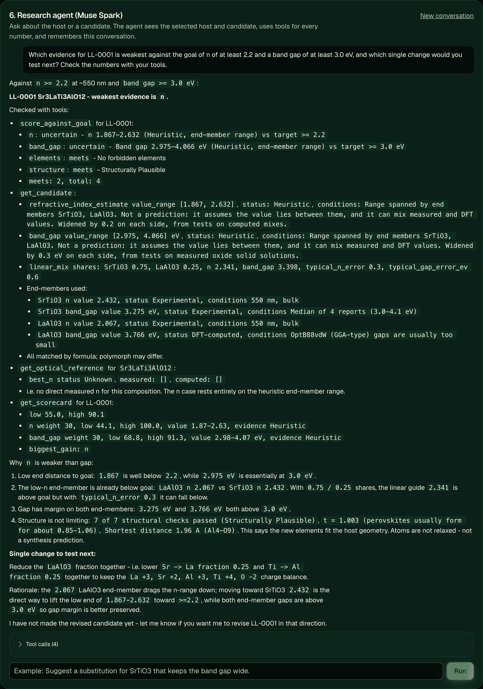</p>
<p align="center"><sub>A real answer. For this answer, the agent made 4 tool calls. In the app, you can open the list under the answer to see each call and what it returned.</sub></p>

### 7. Work in public or in private

Use the switch at the top of the page. Each mode is a separate workspace, so private work leaves the screen when you switch to public.

| | Public mode | Private mode |
|---|---|---|
| **Sign-in** | None | Google |
| **A new candidate** | Anyone can read and change it | Only you can read and change it |
| **You can see** | Public-mode and published candidates | Those, and your own private candidates |
| **Making it public** | It is public already. It has no owner, so nobody can claim it | You choose it, after a check, a warning, and your consent |
| **Someone's published work** | Read it, or revise it into a new candidate | Read it, or revise it into your own private candidate. Their credit stays on your version |

<p align="center">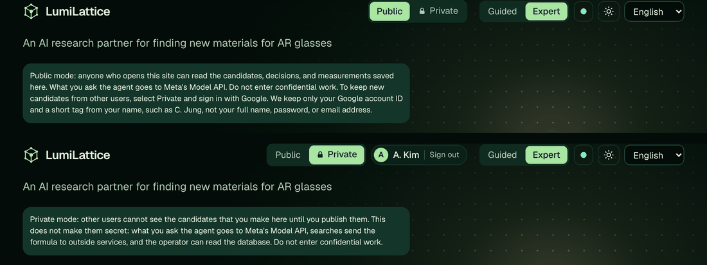</p>
<p align="center"><sub>The same page in each mode. The account in this picture is a test account.</sub></p>

Your own work shows a **Private Material** badge under its name. The same card says if the material is already public, so you do not have to look for this.

<p align="center">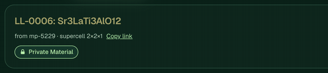</p>

**To make your material public:**

1. If no owner has published it, select **Make public as C. Jung** in the card. The button shows your own tag, which comes from your account name.
2. Read the warning, and give your consent. You can choose anonymous credit here.
3. The badge changes to **Public Material by C. Jung**, with the date and the license.

<p align="center">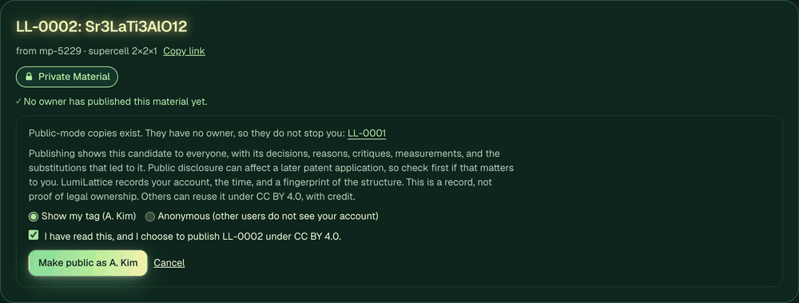</p>
<p align="center">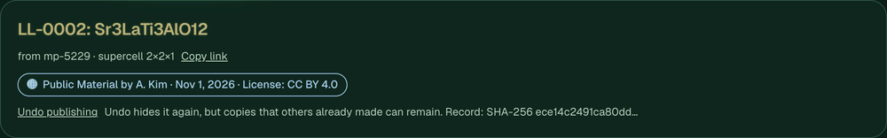</p>
<p align="center"><sub>Before and after. Public-mode copies are listed, but they do not stop you. The account is a test account.</sub></p>

If an owner has already published the material, you cannot publish it again. The card names the public candidate and its author, so you can open it and revise it. The server also refuses the request, so this rule does not depend on the screen.

<p align="center">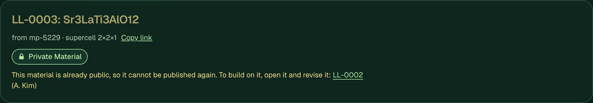</p>

**What counts as the same material.** The same composition on the same crystal framework ([`matches.py`](backend/app/tools/matches.py)). Atom arrangement does not count, because an ordered cell is one model of a disordered solid. A different crystal form, such as rutile and anatase, is a different material, and the app lists it for information. The check compares only public candidates, so it never shows a private one. Thus two researchers can hold the same material in private, and the first to publish it gets the credit.

**What the record shows.** The app records the account's permanent ID, the time, and a SHA-256 fingerprint of the structure, and publishes under CC BY 4.0. This is a record of which account published what and when. Other users see only the short tag. Two people can have the same tag, and Google does not check that a name is real. It is **not proof of legal ownership**, patent priority, or authorship, and being first here says nothing about who was first anywhere else. Public disclosure can affect a later patent application. Undoing a publication hides the candidate again, and it frees the material for others, but copies that others made can remain. Anonymous credit hides your account from other users, and the operator can still see it in the database.

**What private mode does not do.** It keeps your candidates from other users. It does not make them secret: what you ask the agent goes to Meta's Model API, novelty checks and searches send the formula to outside services, and the operator can read the database, which is not encrypted. Candidate IDs are sequential, so an ID can show that a candidate exists elsewhere in the numbering, but not what it is.

**How it works.** The frontend server runs the Google sign-in. It asks only for the `openid` and `profile` scopes, not for the email address. It makes the short tag from your name and does not keep the full name. It keeps only the account's ID and the tag, in a signed HTTP-only cookie. See the [privacy page](https://lumi-lattice.vercel.app/en/privacy). It gives the browser a token that lasts 15 minutes, and the backend checks that token on each request. All candidate paths and agent tools read through one class, [`ScopedStore`](backend/app/storage/scoped.py), and [`test_ownership.py`](backend/tests/test_ownership.py) tests each path and fails if a new path is not listed. A stranger gets 404, so a private candidate looks the same as one that does not exist. A bad or expired token is an error, so private work is never saved as public by mistake.

## How Muse Spark is used

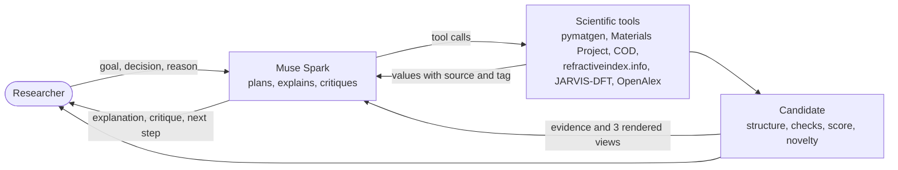

| Muse Spark feature | How LumiLattice uses it |
|---|---|
| **Tool calling** (Responses API) | The agent plans the work and calls 9 scientific tools. The model never writes a number on its own: tools return each value with its source |
| **Conversation state** (`previous_response_id`) | The agent remembers the host, the candidates, and the researcher's reasons |
| **Multimodal input** | The critique reads three rendered views of the crystal, with the swapped atoms labeled, along with the evidence |
| **Strict JSON output** | The critique returns a fixed structure. The app rejects unknown evidence IDs and flags numbers that are not in the evidence |
| **Plain language** | In Guided mode, the agent explains technical terms and stays short. The rules on numbers do not change |

1. The researcher sets optical targets and constraints, and selects a host crystal structure.
2. Muse Spark (Meta Model API, Responses endpoint) plans the work and calls tools. It also reviews each candidate from its evidence and rendered views of its structure (multimodal critique).
3. Tools return values with provenance. The model never writes a number on its own.
4. Each value carries one evidence tag: `Experimental`, `DFT-computed`, `Heuristic`, or `Unknown`.
5. The researcher accepts, modifies, or rejects a candidate, and the agent revises it.

A step bar at the top of the app shows the four steps (goal, host, candidate, evidence and decision), marks the steps that are done, and tells the researcher what to do next. Each step scrolls to its section; the steps can be done in any order.

**Try the AR example** runs the steps once with real data: the AR waveguide goal (n ≥ 2.2, band gap ≥ 3.0 eV), SrTiO3 (mp-5229) as the host, and a candidate with La on 25% of the Sr sites and Al on 25% of the Ti sites. SrTiO3 has a high n; LaAlO3 has a wider gap. The example asks whether the co-substituted candidate keeps both, and points to the evidence views that answer it. It uses the same API calls as a researcher would, so it stays within the free-tier caps.

<details>
<summary><strong>Agent tools</strong></summary>

| Tool | Source | Returns |
|---|---|---|
| `composition_info` | pymatgen | Reduced formula, molar mass, charge-balanced oxidation states |
| `search_materials` | Materials Project | Known structures with DFT band gap, energy above hull, and refractive index, each tagged |
| `search_literature` | OpenAlex, Crossref, arXiv, Semantic Scholar | Paper metadata merged by DOI or title, with the sources that found each paper |
| `create_candidate` | LumiLattice | Substitutes elements on a host or on an earlier candidate (new atoms spread apart, or at the lowest Ewald energy), then runs the structural checks below |
| `get_candidate` | LumiLattice | A candidate's substitutions, checks, n range, measurements, and the researcher's decisions |
| `get_optical_reference` | refractiveindex.info, JARVIS-DFT | Measured n at 450/550/650 nm with sources; DFT band gaps and n (OptB88vdW, TBmBJ) |
| `score_against_goal` | LumiLattice | A candidate's verdicts against the researcher's goal, with evidence |
| `get_scorecard` | LumiLattice | A candidate's 0 to 100 score as a range, with points per metric, the metric with the most points still open, and its rank among known materials |
| `check_novelty` | Materials Project, COD, reference data, papers | Exact matches, related work, and the nearest known compositions. Not found does not mean new |

When a source is not available, the tool returns an error and the agent reports the value as unknown instead of guessing.

</details>

## The science

These are the methods behind the numbers, with the same constants as the code. They are established methods or stated design choices, not new results.

### Optics

The refractive index that comes from a DFT calculation is a long-wavelength value, from the dielectric constant $`\varepsilon`$. Measured values at 550 nm have priority over it.

```math
n = \sqrt{\varepsilon}
```

A candidate has no measured value of its own, so the app gives a **range** between its end members $`i`$, with a margin from the tests below. The linear mix is a guide only, where $`x_i`$ is the share of each end member. Verdicts and the score do not use it.

```math
n \in \Big[\min_i n_i - 0.2,\ \max_i n_i + 0.2\Big]
```

```math
E_g \in \Big[\min_i E_{g,i} - 0.3,\ \max_i E_{g,i} + 0.3\Big]\ \text{eV}
```

```math
\bar n = \sum_i x_i n_i
```

### Score

The score combines six metrics, each from 0 to 100. $`n`$ and the band gap combine as a geometric mean, because AR glasses need both and one cannot make up for the other. The weights are design choices, not measured values.

```math
S = \frac{60\sqrt{s_n\, s_{E}} + 10\, s_\text{Moss} + 10\, s_\text{iso} + 15\, s_\text{fit} + 5\, s_\text{HHI}}{100}
```

The app computes $`S`$ at the worst and the best end of the evidence, which gives the range. Each metric uses straight lines between these points, where $`n^*`$ and $`E^*`$ are your goal values:

| Metric | Quantity | Points |
|---|---|---|
| $`s_n`$ | $`n`$ | 0 at $`\min(1.3,\ n^*-0.1)`$, 70 at $`n^*`$, 100 at $`n^*+0.4`$ |
| $`s_E`$ | $`E_g`$ | 0 at $`\min(1.6,\ E^*-0.1)`$, 70 at $`E^*`$, 100 at $`E^*+1.5`$ |
| $`s_\text{Moss}`$ | $`R = n^4 E_g / (95\ \text{eV})`$ | 0 at $`R = 0.5`$, 50 at $`R = 1`$, 100 at $`R = 2`$. Above 1 beats the usual trend |
| $`s_\text{iso}`$ | Optical class | Isotropic 100, uniaxial 60, biaxial 30 |
| $`s_\text{fit}`$ | Structural checks | Mean of pass 100, warn 50, fail 0. A failed charge check caps it at 30 |
| $`s_\text{HHI}`$ | Herfindahl-Hirschman index of element production, weighted by mass fraction | 100 at 1000, 50 at 2500, 0 at 6000 |

### Do the atoms fit?

**Goldschmidt tolerance factor**, for perovskite-like $`ABX_3`$ with Shannon radii $`r`$. The check passes for $`0.85 \le t \le 1.06`$.

```math
t = \frac{r_A + r_X}{\sqrt{2}\,(r_B + r_X)}
```

**Bond valence sum**, with the universal parameters of O'Keeffe and Brese ($`b = 0.37`$ Å), for bonds $`j`$ of length $`d_j`$ around a cation. The app reports the misfit as the bond-length change $`\Delta d`$ that would bring the sum to the oxidation state $`V_\text{ox}`$, which grades small misfits fairly.

```math
V = \sum_j \exp\!\left(\frac{R_0 - d_j}{b}\right)
```

```math
R_0 = r_c + r_a - \frac{r_c\, r_a \left(\sqrt{c_c} - \sqrt{c_a}\right)^2}{c_c\, r_c + c_a\, r_a}
```

```math
\Delta d = b\,\ln\frac{V}{V_\text{ox}}
```

**Ionic size mismatch**, from the mean bond length $`\bar d`$ at a site. It warns above 10% and fails above 20%.

```math
\text{mismatch} = \frac{(r_c + r_a) - \bar d}{\bar d}
```

### Shape in 3D

For a polyhedron with bond lengths $`d_i`$: the distortion index (Baur 1974) and, for octahedra, the quadratic elongation and bond-angle variance (Robinson et al. 1971). Here $`l_0`$ is the center-to-vertex distance of a regular octahedron with the same volume, and $`\theta_i`$ are the 12 cis angles. For frameworks with only corner-shared octahedra, the tilt comes from the $`B{-}X{-}B`$ angle.

```math
\Delta = \frac{1}{N} \sum_{i=1}^{N} \frac{|d_i - \bar d|}{\bar d}
```

```math
\langle\lambda\rangle = \frac{1}{6} \sum_{i=1}^{6} \left(\frac{d_i}{l_0}\right)^2
```

```math
\sigma^2 = \frac{1}{11} \sum_{i=1}^{12} (\theta_i - 90^\circ)^2
```

```math
\omega = \frac{180^\circ - \angle B{-}X{-}B}{2}
```

The ordering rank compares arrangements of the same atoms by the Ewald energy of point charges $`q`$ with formal values. It is a ranking only, with no screening or relaxation.

```math
E_\text{Ewald} = \frac{1}{2} \sum_{i \ne j} \frac{q_i q_j}{4\pi\varepsilon_0\, r_{ij}}
```

### The cloud picture

Each atom gets a Gaussian with a width from its Shannon radius $`r_i`$. It stretches along its bonds $`b`$, which have unit vectors $`\hat{\mathbf u}_b`$ and bond-valence weights $`w_b = \exp[(R_0 - d_b)/0.37\ \text{Å}]`$. Again, this is a model picture of the geometry, not a computed electron density.

```math
\rho_i(\mathbf r) \propto \exp\!\left[-\tfrac12 (\mathbf r - \mathbf r_i)^{\mathsf T} \Sigma_i^{-1} (\mathbf r - \mathbf r_i)\right]
```

```math
\Sigma_i = (0.42\, r_i)^2 \left[0.4\, \mathbf I + 1.8\, \frac{\sum_b w_b \hat{\mathbf u}_b \hat{\mathbf u}_b^{\mathsf T}}{\sum_b w_b}\right]
```

## How far to trust it

We tested the score against real data, and the tests changed it. These limits matter most:

- About 1 in 7 clear-oxide cases falls outside the range even with the margin, and 24% do when MgO–ZnO is left out. Measured gaps also depend on how the sample was made: the set has films and nanoparticles.
- For n, there are only 12 measured oxide mixes, none reviewed, and several are thin films. The app's measured n values are for bulk crystals, so a real film can have a lower n than the range says.
- Ranking is weak: rank correlation 0.652 on clear oxides, and 0.364 without MgO–ZnO. Small score differences mean little.
- The margins, the spread limit, and the charge rule came from this data, so only the held-out atom-fit numbers are fair tests. The oxide margin has no separate test set.
- Values are matched by formula, so the crystal form can differ (SiC in the tests below; TiO2 has one value for rutile and anatase).
- Impossible swaps can pass the charge check through unusual oxidation states: LaO and LaF2 with La(+2) score 80 in the held-out set, and CsN with N(-1) and CsS with S(-1) score 80 in the tuning set.
- The score has not been tested against whether a material was made or used, beyond the small control list.

<details>
<summary><strong>Scoring and novelty in full</strong></summary>

Each candidate gets two separate answers, because a new material is not automatically a good one. Neither claims that the material can be made or will work.

**Score (0 to 100, always a range).** The range is the worst and the best end of the evidence, so weak evidence shows as a wide range. A metric with no data counts as 0 to 100.

| Metric | Weight | What it uses |
|---|---|---|
| Bends light | 30 | n against the goal; reaching the goal earns 70 points |
| Stays clear | 30 | Band gap against the goal; reaching the goal earns 70 points |
| Beats the trade-off | 10 | n⁴ × gap / 95 eV (Moss relation), from real n and gap pairs; above 1 beats the usual trend |
| Same in all directions | 10 | Optical class, from the ordered model (worst case) to the host's symmetry (best case) |
| Atoms fit together | 15 | The structural checks; a failed charge check caps this at 30 points |
| Easy to source | 5 | Herfindahl-Hirschman index of element production |

n and the band gap count for 60 together, as a geometric mean: AR glasses need both, so one cannot make up for the other. The weights and point scales are design choices, not measured values, and they are shown in the app. The panel also says how much of the score rests on measured, computed, estimated, or model-derived values, and which metric has the most points still open.

**Benchmark.** The 130 materials with a measured n at 550 nm are scored on the three optical metrics, so a candidate can be read as "higher than 76 to 128 of 130". This set favors materials already used in optics, and it holds some doubtful reports (BP is listed at 4.2 eV), so the app compares candidates with well-known optical materials rather than with a top list. The benchmark compares values; a high rank does not show that a material can be made.

**Novelty (four levels).** *Already known* (an observed exact match in Materials Project, COD, or measured reference data), *Computed only*, *Related work exists* (the same elements in Materials Project, or papers that name the system in the title), or *Nothing found*. The panel lists each check with links and the closest known compositions by the share of atoms that differ. An ordered model's formula rarely matches a paper's notation, so the paper check looks for the end members and for the host with each new element. "Nothing found" covers these sources only: it does not check patents, unpublished work, or other notations, and the app never calls a candidate a discovery.

A session leaderboard ranks the candidates, so each new attempt shows whether the idea improved. The agent can read both answers (`get_scorecard`, `check_novelty`), and the JSON export includes the score.

</details>

<details>
<summary><strong>The tests, their data, and the faults they found</strong></summary>

`scripts/validate_score.py` runs these tests and writes `backend/data/validation.json`. The tests changed the score: they exposed three faults, described below.

| Test | Data | Result |
|---|---|---|
| Band-gap range, oxides | 43 hand-checked measured solid solutions, gap ≥ 2.5 eV, 25 chemical systems | End-member range alone: 70% inside. With the 0.3 eV margin: 86% (also 86% at 0.5 eV). Rank correlation of the midpoint: 0.652 |
| The same, without MgO–ZnO | 25 cases (18 cases were one system) | With the margin: 76% inside. Rank correlation: 0.364 |
| Band-gap range, oxides, unreviewed | 103 text-mined solid solutions | With the margin: 63% inside. Lower, likely because of extraction errors and the low-gap oxides included |
| Band-gap range, mostly semiconductors | 219 measured solid solutions (fractional compositions in Zhuo et al.) | Range alone: 63% inside. With the margin: 98% |
| n range, oxides | 12 text-mined measured mixes (6 systems), not reviewed | With the 0.2 margin: 58% inside. Several are thin films, which can have lower n than bulk. BaSrTiO3 reports are 2.02 to 2.16, against about 2.43 for the bulk end members, so the range misses them |
| n range, computed | 192 computed wide-gap oxide mixes (JARVIS TBmBJ) | With the 0.2 margin: 91% inside |
| Text-mined gaps against TBmBJ | 243 formulas with a compiled measured gap | Reports that agree (middle half within 1 eV): mean error 0.171 eV, against 0.626 eV for TBmBJ. Reports that disagree: 0.865 against 1.195 eV (28 oxides: 0.789 against 1.229 eV), and single values can be far off (SiO2 5.7 eV), so the app does not use them |
| Optical score, controls | 8 waveguide materials, 7 opaque, 6 low-n | Highest opaque 61.2 (Fe2O3), highest low-n 38.0. Lowest waveguide material 57.4 (SiC), which fails this control: its text-mined 2.4 eV is mainly cubic 3C-SiC, while AR waveguides use hexagonal SiC. Without SiC, the lowest is 68.0. A sanity check only, because n and the gap build the score |
| Structural checks, no swap | 40 real crystals at their own geometry | 26 raise no alarm. Charge passes on 100%. Distances fail on 4 crystals with short covalent bonds (CO2, TeO2, LiIO3, Ba(BO2)2). The tolerance factor warns on 1 of 3 perovskite-like crystals (BaTiO3, t = 1.062) |
| Atom fit, held-out swaps | 21 real compounds, 8 impossible swaps | 21 of 21 keep their points; 6 of 8 caught; AUC 0.905 |

The oxide cases come from two text-mined databases, so their source sentences were read: 35 of 53 clear-oxide compositions were correct, 11 were corrected, and 7 were left out, mostly for wrong attribution (`backend/data/oxide_gap_review.json` lists each one with its DOI). Up to two sentences were read per composition.

**Faults found and fixed:**

- **One property could make up for the other.** Opaque Fe2O3 scored 70, against 71 for Si3N4. n and the band gap now combine as a geometric mean, because AR glasses need both.
- **Ranges were too narrow.** Ranges now carry a margin: 0.3 eV for gaps, where coverage on hand-checked oxides stops rising, and 0.2 for n.
- **Atom fit could not tell real from impossible.** Without relaxation, the bond-valence check fails on 40% of swaps to real compounds, because the atoms stay in the host's positions. Any failed check capped the score, so KCl and CsF2 both got 30 points. Only a failed charge check caps it now. The checks themselves did not change, so "Structural Concerns" still appears often on 100% swaps.

</details>

## Reference

<details>
<summary><strong>Research goal and evidence charts</strong></summary>

The researcher sets a **goal** first: minimum n near 550 nm, minimum band gap, and forbidden elements. Every host and candidate is scored against it (`meets`, `uncertain`, `fails`, `unknown`). Each verdict cites its evidence and tag; a Heuristic range that spans the target is `uncertain`, never `meets`.

The **Evidence** section shows the data behind each decision, in five views. Every chart has a legend, notes on what the data is, hover tooltips, and a table view:

| View | What it shows |
|---|---|
| n vs band gap | All materials with a measured n (refractiveindex.info, with JARVIS TBmBJ gaps), a sample of JARVIS DFT entries, the empirical Moss relation (n⁴·Eg ≈ 95 eV), the goal region, the host, the end members, and the candidate's n × gap range box |
| Dispersion n(λ) | Measured bulk n(λ) from 380 to 780 nm for the host and end members (no extrapolation), with the candidate's Heuristic band between them |
| Site metrics | For each checked cation site: ionic size mismatch and bond-valence misfit against the warn/fail thresholds, unrelaxed or CHGNet-relaxed |
| 3D structure | Spatial analysis of the host, the candidate, and its relaxed geometry (see below) |
| Goal score | The scored criteria for the host and the candidate |

Chart colors encode the evidence type (aqua = measured, blue = DFT, orange = Heuristic), from a palette validated for color-vision deficiency in light and dark modes.

</details>

<details>
<summary><strong>Refractive index evidence and the bundled data</strong></summary>

Every n value carries one tag, shown with its own color, icon, and text:

| Tag | Where it comes from |
|---|---|
| `Experimental` | refractiveindex.info, measured n at 550 nm (bulk or crystal pages; thin films are listed but not used for the best value). For band gaps: literature values from Zhuo et al. (2018), then text-mined values from Dong & Cole (2022) |
| `DFT-computed` | JARVIS-DFT n = √ε from DFT linear optics (TBmBJ preferred, then OptB88vdW), or Materials Project n. This is a long-wavelength value, not n(550 nm) |
| `Heuristic` | A candidate's **range** spanned by its end members, e.g. SrTiO3 → LaAlO3 for Sr→La + Ti→Al. Not a prediction. Verdicts and the score always use the range. Each end is widened by a tested margin (n: 0.2, band gap: 0.3 eV; see "The tests, their data, and the faults they found"). A candidate whose exact formula has a measured or TBmBJ value uses that value instead |
| `Unknown` | No data |

Band gaps follow the same order: measured values first, then a JARVIS-DFT value (TBmBJ, then OptB88vdW). A formula with a text-mined median (at least 5 reports whose middle half spans 1 eV or less; Dong & Cole, 1,156 formulas before that limit) uses it when the Zhuo et al. compilation has no value; text mining makes errors, so the value's note says so. Compiled gaps are the median of the reports for a formula in the Zhuo et al. compilation (3,895 reports; the 2,458 entries with a gap of 0 are labels for metals and are not used). The compilation does not record the method for each report, so a value can be an optical, direct, or indirect gap, and reports for one formula can disagree (SrTiO3: 3.0 to 4.1 eV). The app shows the median and the spread. Some materials have reports that disagree too widely to use (LaAlO3, Al2O3, SiO2) and keep a `DFT-computed` value, so a candidate's range can mix measured and computed gaps.

A **linear mix** is shown as a guide inside the range: the end-member values weighted by each one's share of the composition (Sr3LaTi3AlO12 is 75% SrTiO3 and 25% LaAlO3). It is typically off by about 0.6 eV for the band gap (median, 43 hand-checked clear oxides) and about 0.3 for n (median, 12 unreviewed cases). It appears only when the composition really is a mix of its end members. Verdicts and the score do not use it: it is closer on average than the range's midpoint (mean error 0.84 against 1.10 eV), but without MgO–ZnO it barely improves (0.82 against 0.86 eV) and ranks worse (rank correlation 0.26 against 0.36).

The reference data is matched by formula, so the polymorph can differ from the selected structure; the app says so next to each value.

The bundled `backend/data/reference.sqlite` (14 MB) holds a subset of JARVIS-DFT 3D (2025-09-24, 93,902 entries) the refractiveindex.info database (release 2026-05-24, 868 measured pages with n in the visible range; "Models and simulations" pages are excluded), and the measured band gaps. To rebuild it:

```bash
cd backend
uv run python -m scripts.download_data       # pinned versions, SHA-256 checked; about 62 MB into data/raw/
uv run python -m scripts.build_reference_db
```

</details>

<details>
<summary><strong>Candidates and structural checks</strong></summary>

A candidate replaces a fraction of one element's sites in a known host (or in an earlier candidate, which records the parent and builds a version history). Partial fractions use the smallest supercell (1, 2, 3, 4, 6, or 8 cells). Atoms are **not relaxed**, so the checks show how well the new elements fit the host geometry.

The researcher (or the agent) chooses where the new atoms go:

- **Spread apart** (default): the replaced sites are as far apart as possible (farthest-point selection), in the smallest supercell.
- **Lowest Ewald energy:** every arrangement of the new atoms is compared by point-charge (Ewald) energy with formal charges, and the lowest is kept. The search uses the same cell as the ordering rank in the 3D structure view (the smallest repeat with at least 2 of each new atom), so the result ranks first there. Up to 50,000 arrangements are compared exhaustively; above that, a seeded random sample is improved by greedy swaps, and the candidate says the result is not guaranteed to be the lowest. Example: for 25% La and 25% Al in SrTiO3, the spread arrangement ranks 6 of 23 distinct energies (+51 meV/atom); the lowest-Ewald candidate (4×2×1 cell, 40 atoms) ranks 1. Point charges have no screening or relaxation, so CHGNet relaxation can change the order.

When every new atom's nearest same-element neighbor is its own periodic image (the cell is one host cell thick in that direction), the 3D view says so instead of calling it clustering: every arrangement in that cell has the same chains.

| Check | Method | Thresholds (heuristic) |
|---|---|---|
| Oxidation states and charge neutrality | pymatgen `oxi_state_guesses` | Fail: no balanced assignment. Warn: needs mixed valence |
| Interatomic distances | Pairwise distances | Fail: < 1.2 Å, or cation–anion < 0.8 × radius sum |
| Ionic size fit | Shannon (1976) ionic radii vs. site bond length | Warn > 10 %, fail > 20 % |
| Coordination environment | First anion shell; Shannon table | Warn: ion not tabulated at that coordination number |
| Bond valence sum | O'Keeffe & Brese (1991) universal parameters, b = 0.37 Å | Graded by the implied bond-length change: warn > 4 %, fail > 10 % |
| Goldschmidt tolerance factor | Perovskite-like ABX3 only | Pass 0.85–1.06, warn 0.80–1.10 |
| Reference analogs | Materials Project search for each 100 % end member | Information only |

Each failed or warned check lists its atom indices. The 3D viewer highlights those atoms, because the CIF is written in P1 and the viewer's atom order matches the backend's site order. The overall result is one of `Structurally Plausible`, `Structural Concerns`, or `Insufficient Evidence` (no anion, so the ionic checks do not apply). These checks do **not** predict whether a material can be synthesized.

</details>

<details>
<summary><strong>3D structure analysis</strong></summary>

The structural checks (see "Candidates and structural checks") look at one site at a time. The 3D structure view looks at the arrangement in space, before substitution, after it, and after CHGNet relaxation (if run):

| Analysis | Method | Why it matters for a waveguide |
|---|---|---|
| Symmetry and optical class | Space group (spglib via pymatgen) → crystal system → isotropic (cubic), uniaxial (tetragonal, trigonal, hexagonal), or biaxial | A non-cubic crystal is birefringent: n depends on polarization and direction |
| Polyhedra | Shape match (octahedron, tetrahedron, square planar), bond-length distortion index Δ (Baur 1974), quadratic elongation ⟨λ⟩, bond-angle variance σ², volume | Distorted polyhedra change local polarizability and can lower symmetry |
| Connectivity | Corner, edge, and face sharing between cation polyhedra, with periodic images; B–X–B angles through corner-shared anions; mean octahedral tilt (180° − angle)/2 for corner-only frameworks such as perovskites | Tilts and bent links are how many oxides accommodate a size mismatch |
| Dopant arrangement | Nearest same-element distance against the shortest possible spacing; flags clustered dopants | Clustering is a sign of a poor model of a random alloy |
| Ordering rank | All arrangements of the same dopants in a repeated cell (at least two dopants each, at most 80 atoms; a seeded random sample of 300 if there are more), ranked by Ewald energy with formal charges | Shows whether the chosen arrangement is electrostatically favorable among the alternatives |

Limits, also shown in the app: an ordered supercell is one model of a disordered solid solution, so its symmetry and arrangement are properties of that model. Small cells cannot show every tilt pattern. Ewald energies are unscreened point-charge energies, for ranking only; when all dopants have the same charge as the ions they replace, every arrangement has the same energy and only relaxation can rank them. The relaxed geometry is compared with the unrelaxed candidate, because relaxation does not move ions between sites.

</details>

<details>
<summary><strong>Electron cloud view</strong></summary>

The 3D viewer has a second picture style, drawn as a real volume with WebGL2 (ray marching with self-shadowing, about 150 lines of shader code and no extra library). `POST /api/structures/cloud` returns the model behind it.

It is **a model picture, not a computed electron density**, and the app says so. Candidates have no DFT calculation to read a density from. Each atom gets a soft Gaussian cloud: its size comes from the Shannon ionic radius, and it stretches along the atom's bonds, weighted by bond valence (O'Keeffe & Brese). So it shows geometry the app already has: large anions, small cations, and which way the bonds pull. An atom on a symmetric site stays round; the oxygens in SrTiO3 stretch toward their two titanium neighbors. A slight noise makes the edges look wispy, and this carries no data. Materials with no anion get round clouds from atomic radii.

Direction shows in three ways: colors by the axis of the stretch (a, b, c), ripples along it (they only show the direction; electrons do not move like this), and a line of text that names the most stretched sites, because colors alone do not work for everyone. Ripples and turning respect the "reduce motion" setting.

</details>

<details>
<summary><strong>Host structures</strong></summary>

- **Materials Project** (DFT): search by formula, elements, or ID.
- **Crystallography Open Database** (experimental, CC0): search by formula; each entry shows its authors, journal, year, and DOI. Oxidation-state labels in CIFs (e.g. `Sr2+`) are removed on import.
- **Your own CIF**.

Materials Project stores many crystals as primitive cells: skewed boxes whose axes are not the crystal axes (anatase has angles of 110°). LumiLattice converts them to the conventional standard cell with spglib (`symprec` 0.01), the cell that textbooks draw, so the structure looks right and supercells follow the crystal axes. The conversion is rejected if the formula or the density would change, and the provenance records the method. Uploaded and COD CIFs keep the cell in the file. The viewer uses an orthographic camera, and it draws atoms on a cell face, edge, or corner again on the opposite side. These copies are for display only and do not count as sites.

</details>

<details>
<summary><strong>Researcher in the loop</strong></summary>

The research agent sees the selected host and the current candidate, and it keeps the conversation (Responses API `previous_response_id`). For each candidate the researcher records a decision with a reason:

| Decision | Effect |
|---|---|
| Accept / Reject | Recorded on the candidate |
| Modify | Recorded, then the agent revises that candidate from the reason and compares the checks |
| Explore alternatives | Recorded, then the agent tests up to 2 alternatives from the reason |

Candidates from the form and from the agent share one version history (parent → child).

Each candidate also has:

- **CHGNet relaxation (local install only):** moves atoms and the cell with a machine-learned potential and runs the same checks on the relaxed geometry; the UI switches between unrelaxed and relaxed views. It needs PyTorch (about 1 GB), so it is not in the hosted image, and the live demo says "local install". CHGNet energies are never compared with DFT energies.
- **Measurements:** the researcher can add a measured n (with wavelength) or band gap, with sample type, method, and reference. The app shows whether a measured n falls inside the candidate's end-member range. LumiLattice records these values as given.
- **Share link:** `?candidate=LL-0003` opens that candidate on the same backend, if the person who opens it can read it.
- **Export:** a CIF of the candidate (and of its relaxed geometry, if relaxed) and a JSON research record (below).
- **Muse Spark critique:** a reviewer's reading of the candidate from its evidence and three views of its structure (below).
- **Registry:** all candidates that you can see, in one table with filters, and a side-by-side comparison of up to 3 (checks, n range, ΔV after relaxation, measurements).

</details>

<details>
<summary><strong>Muse Spark critique</strong></summary>

Muse Spark is multimodal, so the critique gives it two kinds of input:

1. **Evidence items** built by the deterministic tools, each with an ID: every structural check (`check.bond_valence`), the per-site numbers (`site.La0`), the n and band-gap ranges and end members (`optics.n`, `optics.SrTiO3`), the goal verdicts (`goal.band_gap`), the 3D structure analysis (`spatial.symmetry`, `spatial.poly.Al4`, `spatial.links`, `spatial.ordering`), the CHGNet relaxation and the relaxed checks, and the researcher's measurements.
2. **Three rendered views** of the cell, down the a, b, and c axes, captured from the 3D viewer. The substituted atoms are labeled with their site IDs (for example La0), and the element colors are sent as a legend, so the model can tie what it sees to the evidence.

It returns a strict JSON critique: a verdict (`promising`, `mixed`, `weak`, `insufficient_evidence`), a short summary, strengths and concerns, up to 3 suggested next steps, and up to 3 questions for the researcher. Guardrails:

- Every point cites evidence IDs, and unknown IDs are rejected. A point based only on the images says so ("seen in the image").
- Every decimal number in the text must appear in the evidence at the precision written. Muse Spark gets one retry to fix a problem; problems that remain are shown with the critique.
- The critique is labeled "AI review: an opinion, not evidence". It never changes an evidence tag, a check, or a score. The evidence it saw is stored with it, and it is included in the JSON export.
- "Ask the agent to test this" sends a suggestion to the research agent, which makes and checks the new candidate with the usual tools.

</details>

<details>
<summary><strong>Export, publishing, and storage</strong></summary>

| File | Contents |
|---|---|
| `LL-0003.cif`, `LL-0003-relaxed.cif` | The P1 cell (every site, in the same order as the site indices in the app) with a comment header: candidate ID, original host and source, all substitutions from the root formula, the geometry (host positions or CHGNet settings), and the export time. ASCII only, as CIF 1.1 requires; tested with the pymatgen and ASE readers |
| `LL-0003-record.json` | Format `lumilattice.candidate-record/1`: the full candidate (structure, substitutions, checks with their methods, n and band-gap evidence with tags, decisions, measurements, relaxation), its ancestry back to the original host, the goal and goal score, the 3D structure analysis (unrelaxed and relaxed), the data sources with versions, licenses, and SHA-256 of the bundled datasets, the evidence-tag definitions, and the caveats |

The same files are available from the API:

```bash
curl -OJ "http://localhost:8000/api/candidates/LL-0003/export.cif"               # add ?relaxed=true
curl -OJ "http://localhost:8000/api/candidates/LL-0003/export.json?target_n=2.2&min_band_gap=3.0&forbidden=Pb,Cd"
```

**Do not enter confidential work.** In public mode, anyone who can reach the site or the API can list and read each candidate, with its decisions, reasons, critiques, and measurements. In private mode, other users cannot, but the limits in [Work in public or in private](#7-work-in-public-or-in-private) apply. The `visibility` value `private` hides a candidate only if it has an owner. A candidate with no owner stays open, and for it the value means only "not marked as published".

Publishing needs explicit consent and a credit choice, and it is refused if an owner has already published the same material. It changes who can read the candidate in LumiLattice, and it sends nothing outside LumiLattice. With sign-in off, the site offers only public mode, and publishing records a typed name or ORCID without checking it.

Candidates are kept in memory unless `DATABASE_URL` points to a Postgres database; then they survive restarts.

</details>

<details>
<summary><strong>Researcher globe</strong></summary>

The bottom of the page shows a globe with counts by country and the total, labeled as researchers, to show where this research is active. The number counts browsers that opened the tool, once each: it does not check that a person is a researcher, and a person with two browsers counts twice. The frontend server reads the country from the hosting service's header (`x-vercel-ip-country` on Vercel) and sends only the two-letter code to `POST /api/visits`; no IP address, browser detail, or time is stored, and the section says so. Set the same `VISIT_SECRET` on both servers in production, so that only the frontend server can add to the counts, and set `DATABASE_URL`, or the counts reset when the server restarts. A visit with no country header, as in local development, counts as "location unknown". Map data: Natural Earth via `world-atlas` (public domain, ISC); very small countries are in the list but not on the map.

</details>

<details>
<summary><strong>API usage limits</strong></summary>

- Materials Project and OpenAlex responses are cached for 24 hours. OpenAlex stops at 500 searches per day (half of its free daily budget) and stops early if the free budget left for the day falls below $0.05. Materials Project has a cap of 1,000 requests per day.
- Crossref (public pool, 1 request per second), arXiv (1 request per 3 seconds, as its API terms ask), Semantic Scholar (optional free key), and COD are free; they are cached and capped too. If a source rate-limits or times out, it is skipped for 10 minutes so the other sources still answer quickly. No personal email address is sent.
- The public demo protects Meta Model API credits: at most 10 agent requests per client per 10 minutes (the client is the `X-Real-IP` address from Railway's edge; the limiter stores only a hash of it with a random key, and removes it when the window has passed) and 200 per day, with at most 8 tool steps per request. Critiques count as agent requests (one request, plus at most one retry).

</details>

<details>
<summary><strong>Languages</strong></summary>

English and Korean are written by hand. Chinese (Simplified), Japanese, Spanish, and German are machine-translated, mostly by Muse Spark with a strict JSON schema; the script rejects any output that drops a key or a `{placeholder}`, and the UI marks these languages as machine-translated. The site opens in English unless the address names another language. Only strings that a language does not have yet are sent, so earlier translations stay stable. Scientific messages from the backend (check results, findings) are in English.

```bash
cd backend
uv run python -m scripts.translate_ui          # new strings, all four; or e.g.: ja de
uv run python -m scripts.translate_ui --all    # translate every string again
```

The backend writes its sentences in English, because Muse Spark and the exports read them too. The frontend translates them with one template per sentence (`Backend` in `frontend/messages/*.json`, `frontend/lib/backendText.ts`), and `backend/tests/test_backend_text.py` fails if the backend shows a sentence with no template. These stay in English: paper titles, source names, the evidence tags (`Experimental`, `DFT-computed`, `Heuristic`, `Unknown`), the evidence list given to Muse Spark, the exported files, and rarer server errors such as a failed upstream request.

</details>

<details>
<summary><strong>Repository layout</strong></summary>

| Path | Contents |
|---|---|
| `backend/` | FastAPI app: Muse Spark agent loop, tool registry, scientific tools (pymatgen, Materials Project, OpenAlex) |
| `frontend/` | Next.js app in 6 languages: host search (Materials Project or COD), CIF upload, 3D viewer (3Dmol.js), candidates, optical evidence, literature, research agent, Google sign-in |
| `docs/figures/` | The figures in this README, made with LumiLattice |
| `THIRD_PARTY_NOTICES.txt` | Licenses of the bundled data, and the libraries |

</details>

<details>
<summary><strong>Deploy</strong></summary>

The backend and its Postgres database run on Railway, and the frontend on Vercel.

1. **Secret:** make one value for `VISIT_SECRET` with `openssl rand -hex 32`. Both servers need the same value.
2. **Database (Railway):** in a new project, add PostgreSQL. The tables are created at the first start of the backend.
3. **Backend (Railway):** add a service from this GitHub repository and set its Root Directory to `backend`, so that it builds from [`backend/Dockerfile`](backend/Dockerfile). Add these variables:
   - `DATABASE_URL` = `${{Postgres.DATABASE_URL}}`
   - `MODEL_API_KEY`, `MP_API_KEY`, `OPENALEX_API_KEY`
   - `VISIT_SECRET` = the value from step 1
   - `CORS_ORIGIN_REGEX` = `https://lumi-lattice[a-z0-9-]*\.vercel\.app`
   - `MODEL_API_BASE_URL` = `https://<your-site>.vercel.app/api/meta`

   Then generate a public domain under the service's Networking settings, set the health check path to `/api/health`, and open `https://<domain>/api/health`. It should show `"candidate_store":"postgres"`.
4. **Frontend (Vercel):** New Project → import this repository → Root Directory `frontend`. Add `NEXT_PUBLIC_API_BASE_URL` = the Railway URL with `https://` and no trailing slash (type Config), `VISIT_SECRET` = the value from step 1, and `MODEL_API_KEY` = the Meta key (type Secret, no `NEXT_PUBLIC_` prefix), then deploy. `CORS_ORIGIN_REGEX` must match the address that Vercel gives the site.
5. **Check:** open the site, run the example, and confirm that your country appears on the globe.
6. **Spending:** on the Railway workspace Usage page, set an email alert at $5 and a hard limit at $10 (the lowest allowed). At the hard limit, every service in the workspace goes offline until the next billing cycle or until you raise the limit. Also check the Meta billing page for a spend limit, because the site is public; the app's own daily cap is the protection that this repository controls.
7. **Private mode (optional):** without these settings, the site offers only public mode.
   - In the Google Cloud console, open Google Auth Platform. Register the app with user type External, and add your site's privacy page (`/en/privacy`) on the Branding page. To let any Google user sign in, select Publish app on the Audience page.
   - On the Clients page, create a Web application client. Set Authorized redirect URI = `https://<your-site>.vercel.app/api/auth/google/callback`. The app asks only for the `openid` and `profile` scopes.
   - Make one more secret with `openssl rand -hex 32`, for `AUTH_SECRET`. Both servers need the same value.
   - Railway: add `AUTH_SECRET`. `/api/health` should then show `"sign_in_enabled":true`.
   - Vercel: add `AUTH_SECRET`, `GOOGLE_CLIENT_ID`, and `GOOGLE_CLIENT_SECRET` (type Secret, no `NEXT_PUBLIC_` prefix), then redeploy.

**Why Muse Spark calls go through Vercel:** on 2026-10-31 the Meta Model API listed no models for requests from Railway's network (US West) and returned `model_not_found`, while the same key listed nine models from Vercel's network and from a home connection. We do not know the reason. So `frontend/app/api/meta/[...path]/route.ts` forwards the backend's calls to Meta. It accepts only `responses` and `chat/completions`, and only with the secret that the two servers share. If you host the backend on a network that Meta allows, leave `MODEL_API_BASE_URL` unset to call Meta directly.

Without `DATABASE_URL`, candidates and researcher counts are kept in memory and are lost when the server restarts. CHGNet relaxation is not installed in the image; it works only in a local install (`uv sync --group relax`).

</details>

## Run locally

Requirements: Python 3.12 with [uv](https://docs.astral.sh/uv/), Node.js 20+.

Backend:

```bash
cd backend
cp .env.example .env   # then add your MODEL_API_KEY
uv sync --group relax  # --group relax adds CHGNet + PyTorch (optional, about 1 GB)
uv run --group relax uvicorn app.main:app --reload --port 8000
```

Frontend (in a second terminal):

```bash
cd frontend
cp .env.example .env.local
npm install
npm run dev
```

Open http://localhost:3000. The site offers public mode only until you add the private mode settings (see step 7 under Deploy). For a local test of private mode, add `http://localhost:3000/api/auth/google/callback` as a redirect URI.

Tests and live check:

```bash
cd backend
uv run pytest
uv run python -m scripts.smoke_muse   # needs MODEL_API_KEY; Muse Spark calls a real tool
```

## Built during the hackathon

All code in this repository was written during the hackathon period (Oct 27 – Nov 4, 2026). See the commit history for the timeline.

## Data sources and attribution

The file [`THIRD_PARTY_NOTICES.txt`](THIRD_PARTY_NOTICES.txt) has the license text for the bundled data and lists the libraries.
- **Materials Project** — crystal structures and DFT properties, [CC BY 4.0](https://creativecommons.org/licenses/by/4.0/). A. Jain et al., "The Materials Project: A materials genome approach to accelerating materials innovation", *APL Materials* 1, 011002 (2013). Each record links to its Materials Project page.
- **OpenAlex** — scholarly metadata, [CC0](https://creativecommons.org/publicdomain/zero/1.0/). J. Priem, H. Piwowar, R. Orr, "OpenAlex: A fully-open index of scholarly works, authors, venues, institutions, and concepts", arXiv:2205.01833 (2022).
- **pymatgen** — structure parsing and analysis, MIT license. S. P. Ong et al., *Comput. Mater. Sci.* 68, 314 (2013).
- **Shannon ionic radii** — R. D. Shannon, *Acta Cryst.* A32, 751 (1976), as tabulated in pymatgen.
- **Bond valence parameters** — M. O'Keeffe and N. E. Brese, *J. Am. Chem. Soc.* 113, 3226 (1991), as tabulated in pymatgen.
- **3Dmol.js** — 3D viewer, BSD-3-Clause license.
- **JARVIS-DFT** — 3D dataset version 2025-09-24, [CC BY 4.0](https://creativecommons.org/licenses/by/4.0/), [doi:10.6084/m9.figshare.6815699](https://doi.org/10.6084/m9.figshare.6815699). K. Choudhary et al., *npj Comput. Mater.* 6, 173 (2020); optics: K. Choudhary et al., *Sci. Data* 5, 180082 (2018).
- **refractiveindex.info database** — release 2026-05-24, [CC0](https://creativecommons.org/publicdomain/zero/1.0/). M. N. Polyanskiy, *Sci. Data* 11, 94 (2024). Each measured value links to its page and original reference.
- **AR waveguide materials (test controls)** — Huawei patent [US11899241](https://patents.google.com/patent/US11899241) and [Coherent (2024)](https://www.coherent.com/news/blog/ar-displays-high-index-material.html).
- **Experimental band gaps** — [Expt Gap Data](https://doi.org/10.6084/m9.figshare.7289687.v1), MIT license on the Figshare record. Y. Zhuo, A. Mansouri Tehrani, J. Brgoch, "Predicting the Band Gaps of Inorganic Solids by Machine Learning", *J. Phys. Chem. Lett.* 9, 1668 (2018).
- **Text-mined band gaps** — [Dong & Cole](https://doi.org/10.1038/s41597-022-01294-6), *Sci. Data* 9, 193 (2022), [data](https://doi.org/10.6084/m9.figshare.14079863.v1), MIT license on the Figshare record. Used in the app and in the score tests.
- **Text-mined refractive indices** — [Zhao & Cole](https://doi.org/10.1038/s41597-022-01295-5), *Sci. Data* 9, 192 (2022), [data](https://doi.org/10.6084/m9.figshare.12781142.v2), CC BY 4.0. Used in the score tests only.
- **Element production concentration (HHI)** — M. W. Gaultois et al., *Chem. Mater.* 25, 2911 (2013), as tabulated in pymatgen.
- **Crystallography Open Database** — experimental structures, [CC0](https://creativecommons.org/publicdomain/zero/1.0/). S. Gražulis et al., *J. Appl. Cryst.* 42, 726 (2009). Credit the original authors shown with each entry.
- **Crossref** — scholarly metadata (public REST API).
- **arXiv** — preprint metadata via the arXiv API. Thank you to arXiv for use of its open access interoperability.
- **Semantic Scholar** — paper metadata via the Semantic Scholar Academic Graph API.
- **CHGNet** (optional, local) — B. Deng et al., *Nat. Mach. Intell.* 5, 1031 (2023), BSD-3-Clause license.

**Figures.** We made every figure in this README with LumiLattice itself, from our own code, on 2026-10-31 and 2026-11-01. They contain no images from other sources. The crystal comes from Materials Project (mp-5229, CC BY 4.0), and the charts show data from the sources above.

## License

[Apache-2.0](LICENSE)
